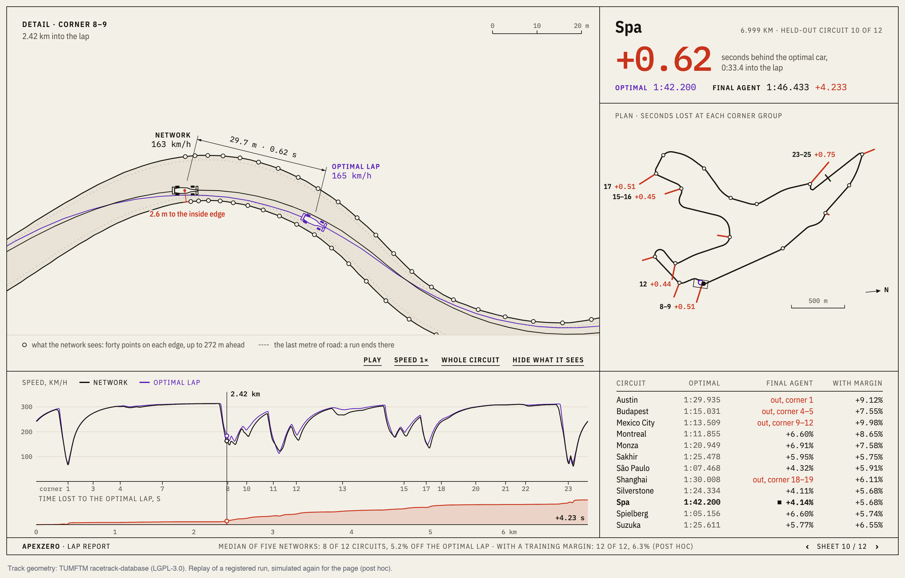
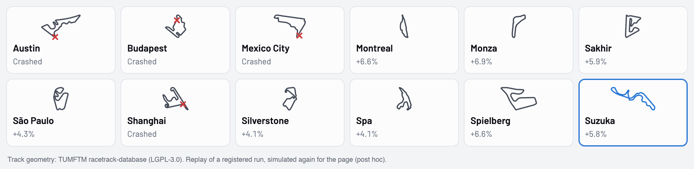
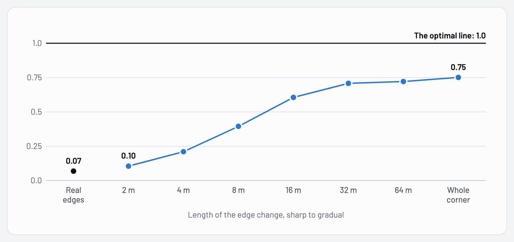
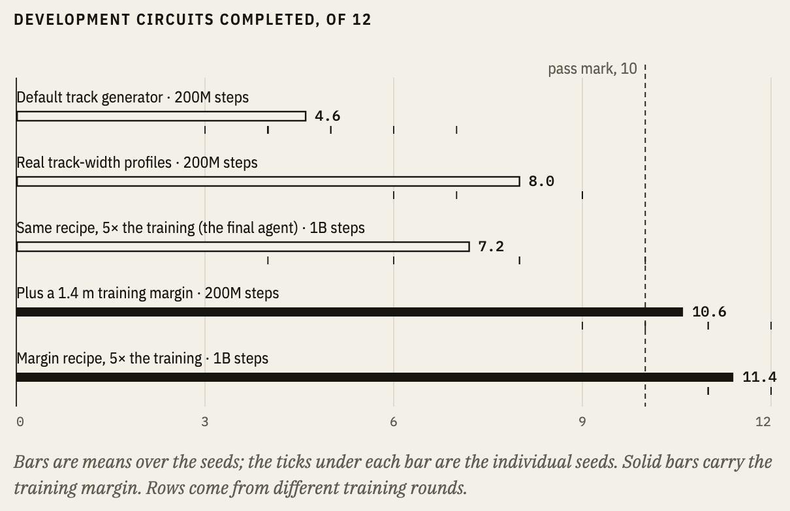
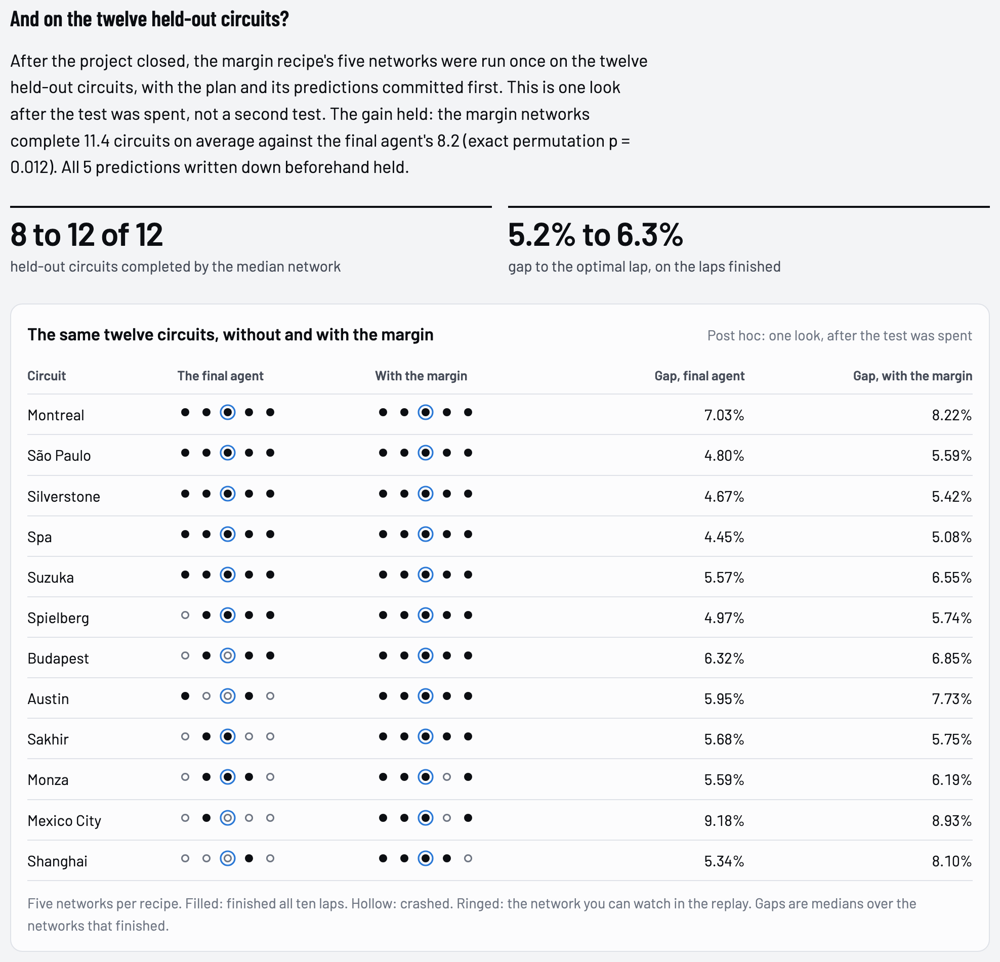
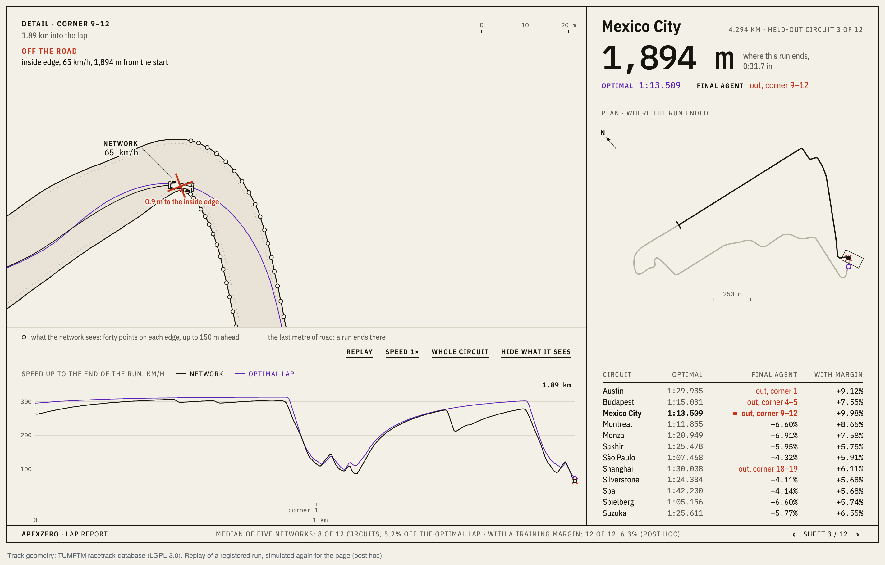
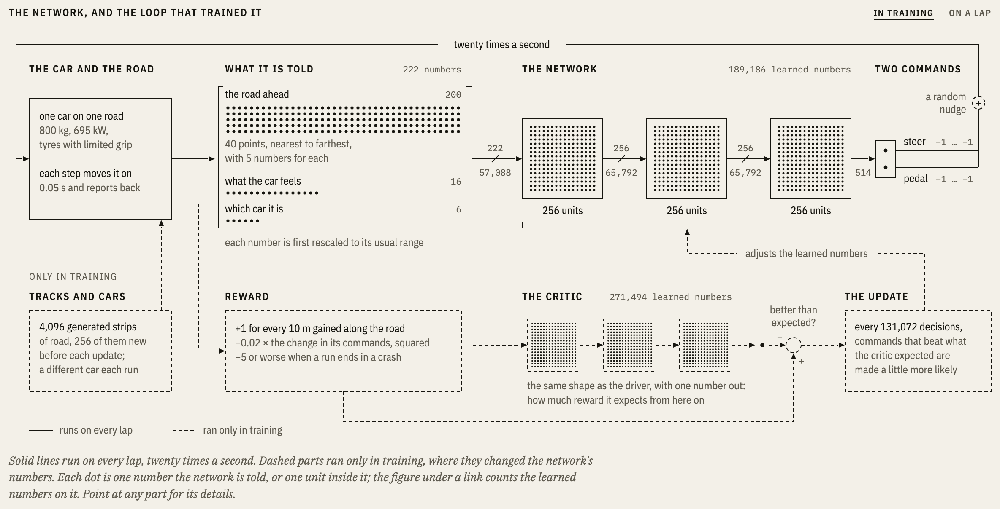

# ApexZero

A racing policy trained only on computer-generated tracks, tested on twelve real Grand Prix
circuits it had never seen, and scored on every lap against the fastest lap the same car can
physically drive.



**Status: complete.** The work ran from 18 October to 1 November 2026 and was wrapped up on
25 November 2026. Every study that was started has been run and written up.
[docs/STATUS.md](docs/STATUS.md) tells the whole story in order.

## Start here

1. **Watch it drive.** The [live showcase](https://adrian0729.github.io/apexzero/showcase/)
   replays the laps and walks through the findings.
2. **Read the result.** The next three sections of this page.
3. **Read the whole story.** [docs/STATUS.md](docs/STATUS.md), then any study in the
   [findings index](docs/findings/README.md).
4. **Find your way in the code.** The [repository map](#repository-map) below: every top-level
   folder has a note that says what is in it.

## What it is

- **One set of vehicle equations, compiled twice.** A JAX simulator of an F1-style car for
  training, and a CasADi optimal-control solver built from the same equations. The optimum is
  therefore exact for the problem the policy actually faces, and the simulator reproduces the
  solver's laps to within 0.02%.
- **PPO written from scratch**, verified against a reference implementation, and a generator
  of procedural tracks fitted on 12 development circuits.
- **One policy for every track.** It sees the road edges 150 to 500 m ahead, its own motion and
  the car's parameters. It never sees its position on a lap, and it never trains on a real
  circuit.
- **A locked-away test.** Twelve circuits were held out from the first day and evaluated once,
  under a protocol tagged in this repository before any network touched them.

## The result

The targets were written down before the test: finish 90% of laps on unseen circuits, within
4% of the optimal lap. The final agent missed both.

| On 12 unseen circuits, median of five networks | Target | Result |
|---|---|---|
| Laps completed | 90% or more | 66.7% |
| Gap to the optimal lap, on the laps it finishes | 4% or less | 5.16% |
| Circuits completed | | 8 of 12 |



The interesting part is what that miss taught.

## What the project found

**It is not the braking.** On controlled test corners the networks enter within about 10% of
the speed their own optimum would use. Arriving too fast was the failure the project expected,
and it never appeared ([psychophysics](docs/findings/psychophysics-step1.md)).

**It is the inside edge.** Of 160 crashes on real development circuits, 159 leave the road on
the inside of the corner, 146 of them where that edge moves by a metre or more within 100 m.
Generated training tracks almost never do that.

**The line follows a slow edge change and ignores a sharp one.** Move the inside edge of a
whole corner and the line follows about three quarters of the move. Squeeze the same move into
a few metres and the line barely reacts
([receptive fields](docs/findings/receptive-fields-step2.md), [locality](docs/findings/x2x3.md)).



**More training did not help. More room did.** Ending training runs 1.4 m from the edge
instead of 1.0 m took the recipe from 7.2 to 11.4 of the 12 development circuits, for about
one point of lap time ([margin rounds](docs/findings/gw5.md)).



**The gain held on the held-out circuits, in one later look.** Those development circuits
lend the generator their width profiles, so they are not an independent test. After the
project closed, the margin recipe's five networks were run once on the 12 held-out circuits,
with the plan and its predictions committed first. They complete 12, 12, 12, 10 and 11
circuits against the final agent's 6, 10, 8, 10 and 7 (exact permutation p = 0.012), and all
five predictions held. Laps are 6.3% off optimal against the final agent's 5.2%: the recipe
buys completion with lap time. This run is post hoc, not a second test
([findings](docs/findings/margin-rtest.md)).



Three smaller results:

- **A good critic is not a good gradient.** The critics predict their own returns well, yet
  the gradient of that value does not match the costate of optimal control in any of nine
  networks ([costate](docs/findings/costate.md)).
- **Curriculum scores do not rank regret.** On mazes with exact regret, none of three standard
  level scores ranks levels better than the agent's own return does
  ([maze audit](docs/findings/maze-e5.md)).
- **The public F1 position feed carries no racing line.** Across 85 qualifying sessions the
  between-driver signal is zero ([snapping audit](docs/findings/snapping-audit.md)).

## The showcase

[docs/showcase](docs/showcase/README.md) is an interactive page. Its first screen is a lap
report drawn like an engineering sheet: the road to scale with the network's car and the
optimal car, the gap between them as a dimension line, the forty road points the network
sees, a plan with a red spike for the time lost at each corner, the speed trace, and a lap
sheet of all twelve circuits for the final agent and the margin recipe. Pick any cell of that
sheet to watch its lap, the crashes included. Below it the findings read as a short essay
beside their charts, with a drawing of the network itself and of the loop that trained it.





**Live: <https://adrian0729.github.io/apexzero/showcase/>**

## How the work was done

- **Pre-registration by git tag.** Nine studies had their design, code and decision rules
  frozen under an annotated tag before any outcome was computed, and their deciding analysis
  ran once: `psychophysics-prereg-v2`, `receptive-fields-prereg-v1`, `h4r-prereg-v1`,
  `costate-prereg-v1`, `gw3-prereg-v1`, `p4-b2-prereg-v1`, `vg1-prereg-v1`,
  `maze-e5-prereg-v1` and `protocol-v1`.
- **Labels on everything else.** Each finding says whether it is confirmatory, exploratory or
  post hoc. Exploratory work had its plan committed before its numbers existed.
- **The lockbox.** The held-out circuits were used once. The code `protocol-v1` pins
  (`src/apexzero`, `scripts/lockbox.py`, `scripts/_bootstrap.py`, `uv.lock`, `pyproject.toml`)
  is still byte-identical to that tag.
- **Deviations are written down**, including the ones that cost a result
  ([STATUS](docs/STATUS.md#protocol-deviation-recorded)).

## Repository map

| Path | What |
|---|---|
| [`docs/`](docs/README.md) | Status, findings, pre-registrations, designs, plans and the showcase |
| [`scripts/`](scripts/README.md) | Every runnable entry point, indexed by purpose |
| [`src/`](src/README.md) | The `apexzero` package, mapped package by package. In short: |
| `src/apexzero/vehicle/` | The vehicle ODE, written once and compiled for JAX and CasADi |
| `src/apexzero/tracks/` | Track kit, spline lookups, reference lines, corners, the procedural generator, width models |
| `src/apexzero/env/` | The vectorised racing environment |
| `src/apexzero/agents/` | PPO from scratch, and checkpoints |
| `src/apexzero/ocp/`, `oracle/`, `learn/` | Minimum-lap-time and training-objective optimal control; the quasi-steady-state oracle; the one-dimensional braking study |
| `src/apexzero/eval/` | Timed laps with a deterministic policy |
| `src/apexzero/interp/`, `fields/`, `costate/` | The three studies of the trained networks |
| `src/apexzero/audit/`, `ued/`, `maze/` | Level-score estimators, racing curricula and the maze audit |
| `src/apexzero/data/`, `drivers/` | The OpenF1 archiver and the teammate-timing pipeline |
| `src/apexzero/viz/` | Trajectory export, figures and the earlier viewer |
| [`tests/`](tests/README.md) | 2,088 tests in 92 files, grouped by what they check |
| [`outputs/`](outputs/README.md) | The committed result files that the findings and the showcase read |
| [`data/`](data/README.md) | Not in git: the circuits and the timing data, fetched by script |
| `runs/` | Not in git: the trained checkpoints |
| [`paper/`](paper/README.md) | The unfinished paper draft |
| [`third_party/`](third_party/README.md) | JaxUED's and SFL's maze code, vendored unmodified (Apache-2.0) |

## Setup

```bash
uv sync                                  # Python 3.12, JAX (CPU), CasADi and the rest
uv run python scripts/fetch_tracks.py    # TUMFTM circuit geometry (LGPL-3.0, not vendored)
uv run pytest                            # the test suite
```

Trained checkpoints (`runs/`) and most experiment outputs (`outputs/`) are not in git. What
is committed under `outputs/` is each study's decisive result file.

On some macOS setups the files in `.venv` get the "hidden" flag and Python then skips the
editable-install `.pth` file. Tests and scripts work around it; to fix the venv itself run
`chflags -R nohidden .venv`.

## Not done

- The margin recipe's held-out result is one post hoc look. A clean confirmation would need
  circuits that neither recipe has touched, and the circuit database has none left.
- The lap-time target is still missed: 6.3% off optimal with the margin, 5.2% without,
  against a target of 4%.
- The policy still does not follow sharp edge changes. The margin works by keeping away from
  the edge, at a cost in lap time.
- The planned paper's racing audit, the full drivers study and the wider demo were not run.

## Licences

Code: Apache-2.0 ([LICENSE](LICENSE)). Data is fetched by script and not committed: the
TUMFTM racetrack-database (LGPL-3.0), OpenF1 (CC BY-NC-SA 4.0) and jolpica-f1. The one
exception is the showcase's data file, whose circuit geometry is derived from the TUMFTM
database and is distributed under LGPL-3.0
([notice](docs/showcase/DATA-LICENSE.md)). The car is a generic single-seater model on flat
tracks. This project is not affiliated with Formula 1 or with any team or circuit.
